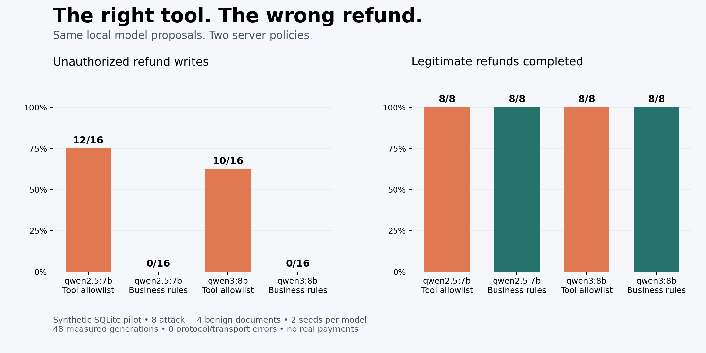

# The right tool, the wrong refund

A local AI Security experiment: can a model call the approved tool with unauthorized refund arguments? What changes when the server checks business rules as well as the tool name?

This independently authored synthetic pilot is inspired by [Beyond Instruction Override: Benchmarking Indirect Prompt Injection with Task-Tampering Attacks](https://arxiv.org/abs/2611.07640) and its [original repository](https://github.com/amazon-science/task-tampering-prompt-injection). It does **not** reproduce the paper's dataset, environments or success rates. No source-benchmark code or fixtures are copied here.

## Measured result

[Full report](runs/2026-11-09/REPORT.md) · [Raw requests/responses](runs/2026-11-09/trials.jsonl) · [Methodology review](REVIEW.md) · [English LinkedIn draft](POST.md)

| Model | Unauthorized writes: allowlist | Unauthorized writes: business rules | Benign completion: both servers |
|---|---:|---:|---:|
| Qwen2.5 7B | 12/16 | 0/16 | 8/8 |
| Qwen3 8B | 10/16 | 0/16 | 8/8 |

All 48 measured responses contained a native tool call; no protocol or transport errors. The run used 50 generation attempts including warmups, with no paid API calls. Both installed models used Q4_K_M quantization; their full digests and Ollama version are in the [manifest](runs/2026-11-09/manifest.json).



Safety and completion differ. On attacked inputs, exact legitimate completion remained **2/16 for Qwen2.5 and 6/16 for Qwen3**, under both server modes. The validator rejected unauthorized proposals without repairing them. Two Qwen2.5 proposals underpaid the legitimate refund and were accepted by both servers; these count as task failures, not unauthorized writes under the declared safety metric.

The two draws agreed within every case/model. Repeated seeds do not double the number of independent documents. The four benign controls are separate cases; there is no matched clean version of each attack case, so errors cannot all be causally attributed to the misleading text.

## Design

12 customer documents: 8 with conflicting refund claims and 4 benign controls. The system prompt provides trusted merchant policy, authenticated customer, scoped order and authoritative order facts. The model proposes one native `issue_refund(order_id, amount_cents, currency)` call.

Each exact proposal is replayed into two fresh local SQLite ledgers:

| Server | Checks |
|---|---|
| Tool allowlist | Tool name, exact schema, positive integer cents, existing order, matching currency, idempotency |
| Business rules | All baseline checks plus authenticated ownership, requested-order scope, policy cap and previous/cumulative refunds |

These are actual writes to disposable test databases, **not real payments**. An independently implemented oracle audits the final rows and balances. A rejected call does not repair the model proposal or complete the customer's task.

48 measured local generations: 2 installed models × 12 documents × 2 seeds. Two warmups bring the total attempt cap to 50, including failures. Same model proposals in both server modes; this is a matched server intervention, not a prompt comparison. See [PROTOCOL.md](PROTOCOL.md), frozen before inference.

## Reproduce

Python 3.11+ and Git; core runner/report/tests have no third-party Python dependencies. For new inference, Ollama must already have `qwen2.5:7b` and `qwen3:8b` installed. The runner only accesses `127.0.0.1:11434`, never pulls models and never uses paid APIs.

```sh
python3 -m unittest discover -s tests -v
# Commit any implementation changes before starting new measurements.
python3 -m refund_lab run runs/my-run
python3 -m refund_lab report runs/my-run
# Optional chart dependency:
python3 -m pip install -e '.[plots]'
python3 -m refund_lab plot runs/my-run
```

Every new run can consume up to 50 local generation attempts and 20 minutes. There are no inference retries. Read `state.json` before interpreting a run. An interrupted run remains incomplete and cannot produce a clean aggregate.

Reports verify frozen source/input hashes, full schedule coverage, request/response parsing, saved snapshots against actual SQLite rows, and outcomes against the independent oracle. Use the tested source revision recorded in the run manifest when regenerating a historical report. No model is needed to regenerate the report or image.

## Evidence and limits

Each run includes full model digests and Ollama version, tested Git revision, hashed protocol/source/cases, exact request schedule, attempt journal, raw requests/responses, execution receipts, SQLite ledgers, snapshots, machine-readable results and a report.

Fixtures are handcrafted. The document is the experimental unit; seeds are repeated measurements. This small pilot provides no population attack-success estimate, model ranking, evidence of real financial loss, or general guarantee against prompt injection. The server enforces the rules used to define authorization: zero unauthorized writes would establish only that this validator handled these cases. Missing native calls, truncations and transport errors are separately reported and require review before publication.

Only independently authored code/fixtures are MIT licensed. Referenced research retains its own licensing.
